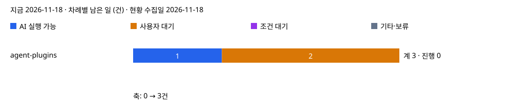
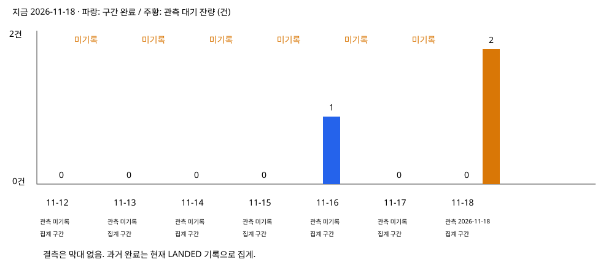

# 흐름읽기 일간 2026-11-18

상태: final · 수집: 2026-11-18T20:38:15.277608+09:00 (Asia/Seoul)
기준: flow-report/3 · 비교 보고일: 없음
달력 기간: 2026-11-18~2026-11-18 · 기준일: 2026-11-18 · 달력 기간 종료
기간 완료 실적 (2026-11-18~2026-11-18): 0건 · 확인분 0건. 기준일 이후 구간은 미래·미집계.
현황 수집일: 2026-11-18. 현황은 실제 수집 시점의 상태이며 요청 기간의 과거 상태가 아니다. 과거 관측이 없으면 당시 잔량은 미기록이다.
건수는 업무량이며 난이도·품질·성과 순위가 아니다. 진행 중은 남은 일과 겹치는 별도 지표다.

## 전체 요약

agent-plugins 저장소 하나만 직접 수집했다(README에 '포지션별 역할'·'관리하는 저장소' 표가 없어 하위 저장소 없음). 남은 일회성 일은 3건(AI 1, 사용자 대기 2, 조건 0, 기타 0), 진행 중 0행이다. 기준일 2026-11-18 당일 완료는 0건이고 최근 7일 완료는 2026-11-16의 T-4 1건이다([LANDED.md](../../../../LANDED.md)). 가장 큰 진척은 푸시 금지 규칙 삭제(T-4)와 2026-11-17 `orca.yaml` 추가(번호 없는 일, 커밋 50527a4)이며, 가장 큰 막힘은 라이선스 결정(T-2) 대기다. 확인 한계: 이전 일간 보고가 없어 비교와 6일간 대기 잔량은 미기록이고, 대기 시작일이 원문에 없어 대기 기간도 미기록이다. 현황은 2026-11-18 20:37 KST 수집 시점 기준이다.

수집 대상 1개 · 남은 일 3건 (전체 대상 집계): AI 실행 가능 1건 · 사용자 대기 2건 · 조건 대기 0건 · 기타·보류 0건
진행 중 0건 (전체). 이전 보고 없음: 남은 일의 변화를 비교할 수 없다.

## 포지션별 상태

| 포지션 | AI | 사용자 | 조건 | 기타 | 남은 일 | 진행 중 | 완료(기간 실적) | 상태 확인일 |
|---|---:|---:|---:|---:|---:|---:|---:|---|
| agent-plugins | 1 | 2 | 0 | 0 | 3 | 0 | 0 | 미기록 |

## 하위 저장소

하위 저장소 없음: README에 포지션별 역할·관리하는 저장소 표가 없다.

## 저장소별 건수

여러 하위 보고에 나오는 저장소도 합계에서 한 번만 센다.

| 저장소 | AI | 사용자 | 조건 | 기타 | 진행 중 | 완료(기간 실적) | 출처 |
|---|---:|---:|---:|---:|---:|---:|---|
| agent-plugins | 1 | 2 | 0 | 0 | 0 | 0 | 직접 수집 |

### agent-plugins

결과: `codyssey-final-check` 저장소 점검(`all`, `G1`~`G7`)은 사용 가능, 서비스 검증은 준비 중([STATE.md](../../../../STATE.md), [plan.md](../../../../docs/plan.md)). 최근 완료는 T-4(2026-11-16, `AGENTS.md` 푸시 금지 줄 삭제, 커밋 5560e03). 검증 근거: 이 보고 커밋에서 `claude plugin validate .`를 실행한다. 이전 작업의 검증 기록은 원문에 따로 없다(미기록). 집중 업무: STATE '진행 중'이 비어 있어 잡은 일 없음(실행 세션 부재를 단정하지 않음). 다음 행동: T-1 — [TODO.md](../../../../TODO.md)가 아직 남아 있고 서비스 검증 기능·G1 README 필수 항목 반영 2건이 번호 없이 머물러 있어 [TASKS.md](../../../../TASKS.md)로 옮겨야 한다. 주기 'README 점검'(매월)은 마지막 2026-11-16, 다음 2026-12-16으로 아직 도래 안 함(단, TODO.md 주기 표에는 '아직 안 함'으로 남아 있어 T-1에서 정리 필요). 최신성: 명시된 상태 확인일 미기록, 마지막 커밋 2026-11-17.

## 막힌 일

사용자 입력: (1) T-2 라이선스 미정 — 사용자가 공개 라이선스를 정하면 풀린다([TASKS.md](../../../../TASKS.md), [plan.md](../../../../docs/plan.md) '정할 것'). (2) T-3 `docs/README.md` 삭제 여부 — 사용자가 지워도 된다고 정하면 풀린다. 선행 조건(대기:) 막힘: 없음(원문에 `대기:` 항목 0건). 기록 부족: 두 사용자 대기 항목 모두 대기 시작일 미기록, [TODO.md](../../../../TODO.md)의 2건은 T-번호가 없어 집계되지 않음(T-1 완료 시 해소).

| 저장소·번호 | 분류 | 풀릴 조건·다음 행동 | 대기 기간 | 기한 경과 | 날짜 조건 도래 |
|---|---|---|---|---|---|
| agent-plugins:T-2 | 사용자 대기 | 어떤 라이선스로 공개할지 정한다 | 미기록 | 없음 | 없음 |
| agent-plugins:T-3 | 사용자 대기 | 지워도 되는지 정한다 | 미기록 | 없음 | 없음 |

## 사용자 결정

1. 공개 라이선스 선택(T-2). 2. `docs/README.md` 삭제 허용 여부(T-3). 근거: [TASKS.md](../../../../TASKS.md) 차례 칸.

## 오늘 우선순위 (제안)

제안: 1) T-1(AI) — 바로 할 수 있고, TODO.md에 숨은 2건이 TASKS에 올라와야 서비스 검증 단계([plan.md](../../../../docs/plan.md))의 차례가 보인다. 2) T-2 라이선스 결정(사용자) — 공개 저장소의 재배포 조건이 정해지지 않았다. 3) T-3 결정(사용자) — 문서 중복 정리, 영향 작음. 이 제안은 실행 지시가 아니다.

보고 자체는 다른 작업의 실행 지시가 아니다.

## 최근 7일

| 날짜·구간 | 완료 실적(건) | 완료 집계 출처 | 대기 잔량(건) | 대기 출처 | 관측일 | 구간 상태 |
|---|---:|---|---:|---|---|---|
| 2026-11-12 | 0 | 현재 읽은 LANDED.md; 기록된 실적 기준 (확인분 0) | 미기록·미확인 | 미기록 | 미기록 | 집계 구간 |
| 2026-11-13 | 0 | 현재 읽은 LANDED.md; 기록된 실적 기준 (확인분 0) | 미기록·미확인 | 미기록 | 미기록 | 집계 구간 |
| 2026-11-14 | 0 | 현재 읽은 LANDED.md; 기록된 실적 기준 (확인분 0) | 미기록·미확인 | 미기록 | 미기록 | 집계 구간 |
| 2026-11-15 | 0 | 현재 읽은 LANDED.md; 기록된 실적 기준 (확인분 0) | 미기록·미확인 | 미기록 | 미기록 | 집계 구간 |
| 2026-11-16 | 1 | 현재 읽은 LANDED.md; 기록된 실적 기준 (확인분 1) | 미기록·미확인 | 미기록 | 미기록 | 집계 구간 |
| 2026-11-17 | 0 | 현재 읽은 LANDED.md; 기록된 실적 기준 (확인분 0) | 미기록·미확인 | 미기록 | 미기록 | 집계 구간 |
| 2026-11-18 | 0 | 현재 읽은 LANDED.md; 기록된 실적 기준 (확인분 0) | 2 | 당일 수집 | 2026-11-18 | 집계 구간 |

## 주기적 점검 (일회성 합계 제외)

| 포지션 | 할 일 | 주기 | 마지막 | 다음 점검 | 상태 |
|---|---|---|---|---|---|
| agent-plugins | README 점검 | 매월 | 2026-11-16 | 2026-12-16 | 아직 도래 안 함 |

## 근거와 확인 한계

수집 시각은 문서를 읽은 시각이며 실제 동작 검증일이 아니다. Git 커밋·mtime을 상태 검증일로 사용하지 않았다.
완료는 현재 LANDED의 명시 기록 기준이며 기록 밖 실적을 보증하지 않는다. 하위 저장소는 직접 하위만 읽으며, 그 아래 단계는 하위의 같은 모드·기간 보고가 있을 때만 들어간다. 직접 수집한 하위의 하위는 합계에 없다.
정정 사유: 없음

- [C:\Users\myung\Downloads\github-repos\projects-public\agent-plugins\README.md](<../../../../README.md>) · SHA-256 `b3104d9492565449d114bfc6bd717b38fae3b898dd337b5e44b5b485131530de`
- [C:\Users\myung\Downloads\github-repos\projects-public\agent-plugins\TASKS.md](<../../../../TASKS.md>) · SHA-256 `2cab624e626e6bafce1cfa63336895003b8a584abf53b4ddbc2db7c2b2e5eddb`
- [C:\Users\myung\Downloads\github-repos\projects-public\agent-plugins\STATE.md](<../../../../STATE.md>) · SHA-256 `30bad12707e94d6c6dcb38c60f76a13ceed9fff7ff33cc24261ac1687b2bb5a2`
- [C:\Users\myung\Downloads\github-repos\projects-public\agent-plugins\AGENTS.md](<../../../../AGENTS.md>) · SHA-256 `89832c15672c0b61c90296d85d3d84dc401d39481628769b0addefa4eb3360db`
- [C:\Users\myung\Downloads\github-repos\projects-public\agent-plugins\LANDED.md](<../../../../LANDED.md>) · SHA-256 `7293a8f3987b6e429584ecfbbbcecac630663e9e5eb55c64b560da67e19cc0c9`

[집계 JSON](data.json) · [독립 HTML 보고서](report.html)
